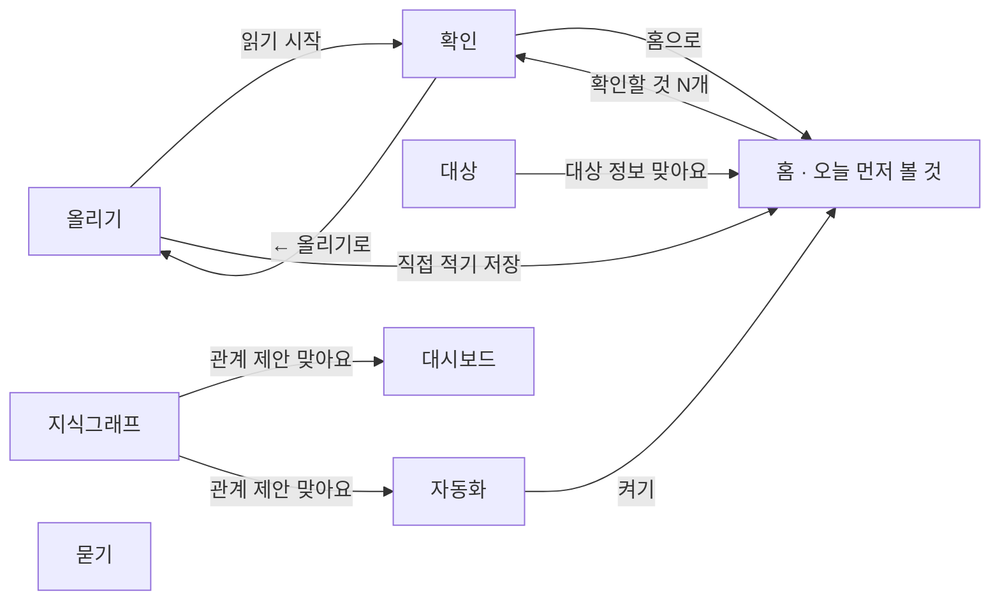

# PRD — papersolve

- 손으로 적은 종이를 찍으면 AI가 칸을 읽고 표 구조, 대상(품목·설비·고객 등)과 그 정보, 관계를 제안한다. 사람이 예/아니오로 확정한 지식 위에서 질문에 근거와 함께 답하고, 대시보드와 자동화로 업무를 챙긴다. 구조가 잡힌 기록은 같은 칸으로 바로 적고, 필요한 지표와 자동화는 말로 청한다.
- 이 문서는 메인 PRD(`~/Desktop/papertolveai/PRD_Tolve_v3.1_SaaS.md`)의 웹 프로토타입 범위다. 핵심 루프(수집 → 구조 → 확인 → 활용)를 가장 얇게 한 번 관통한다.

## 1. 문제

### 배경

일상과 업무의 기록은 종이·손글씨·엑셀에 흩어져 있고 구조가 없다. 그래서 통계·차트·질문·자동화를 매번 사람이 손으로 한다. 엔터프라이즈는 FDE(고객 현장에서 데이터 구조를 잡아 주는 엔지니어)가 이 간극을 메우지만, 개인과 중소 조직은 그럴 수 없다.

- 예: 제조 점검 담당은 매일 점검표를 손으로 적고 사무실에서 엑셀에 옮겨 적는다. 시간이 들고, 오타가 나고, 칸이 밀린다. 양식이 바뀌면 지난 엑셀을 다 고치고, 그래프에 데이터를 더하려고 엑셀을 반복해서 고친다.
- 예: 유통 대표는 재고표를 훑어 발주할 품목을 직접 고르고, 공인중개사는 수첩에서 이번 주 미팅을 찾는다.

### 목표

1. **옮겨 적기를 없앤다**: 사진이나 CSV를 넣으면 표의 행마다 기록이 쌓인다. 구조가 잡힌 뒤에는 같은 칸으로 바로 적는다.
2. **구조는 AI가 제안하고 사람은 예/아니오만**: 기록 종류·칸·대상·대상 정보·분류·관계를 AI와 규칙이 제안하고 사용자는 카드로 확정한다. 업종별 규칙을 미리 넣어 두지 않는다.
3. **대상이 지식의 중심이다**: 품목·설비·고객 같은 대상을 한 번 등록하면, 대상마다 정보(최소 재고·기준·연락처)와 별칭을 한 곳에 두고 여러 기록이 그 대상을 가리킨다. 사용자는 대상 정보를 직접 고칠 수도 있다.
4. **확정한 관계가 일을 한다**: 확정한 관계와 기록이 들어오던 간격에서 대시보드 지표와 자동화 규칙이 나온다. 필요한 지표와 자동화는 대화로 청하고 이어서 고치면, AI가 확정한 지식 안에서 청한 모양 그대로 만든다.
5. **물으면 근거와 함께 답한다**: 답과 숫자는 기록에서 찾고 센 것이고, 근거 기록과 원본 사진이 함께 보인다. 구조를 확정해서 답이 어떻게 달라졌는지 나란히 볼 수 있다.
6. **모든 숫자는 원본으로**: 표·지표·답·요약의 숫자마다 근거 기록과 원본 사진으로 간다.

## 2. 사용자

일상과 업무에서 종이·손글씨·엑셀로 기록하는 개인과 조직. 업종으로 나누지 않고 역할로 본다.

| 역할 | 하는 일 |
|---|---|
| 현장에서 적는 사람 | 종이를 찍어 올린다 |
| 실무 담당 | 확인 카드에 답하고, 관계와 자동화를 확정하고, 기록에 대해 묻는다 |
| 대표 | 홈의 "오늘 먼저 볼 것"과 대시보드를 본다 |

엔진과 화면은 쓰임과 상관없이 같다. 쓰임별로 생기는 구조의 예는 [idea/ipo.md](idea/ipo.md)의 "쓰임별 예"에 있다.

### 사용자 스토리

1. 기록하는 사람으로서, 종이 사진 한 장을 넣으면 행마다 기록이 표에 들어가게 하고 싶다. 엑셀에 옮겨 적는 시간을 없애기 위해서다.
2. 실무 담당으로서, 처음 보는 기록의 표 구조를 AI가 제안하면 맞는지만 답하고 싶다. 양식을 직접 설계하지 않기 위해서다.
3. 실무 담당으로서, 이름만 다른 칸과 읽기 애매한 값만 확인하고 싶다. 모든 값을 다시 보지 않기 위해서다.
4. 실무 담당으로서, 칸 사이 관계(예: 최소 재고는 현재 재고의 최소 기준)를 확정하면 그 관계로 지표와 먼저 볼 것이 만들어지게 하고 싶다. 규칙을 직접 짜지 않기 위해서다.
5. 실무 담당으로서, 품목·설비·고객 같은 대상의 정보(최소 재고, 기준, 연락처)를 대상마다 한 번만 두고 직접 고치고 싶다. 기록마다 같은 값을 다시 적지 않기 위해서다.
6. 실무 담당으로서, 다르게 적힌 같은 대상(설비A, 설비 A)을 하나로 보고, 대상을 분류로 묶어(식품·소모품) 보고 싶다. 같은 것을 따로 세지 않기 위해서다.
7. 대표로서, 홈 맨 위에서 오늘 먼저 볼 것을 보고 싶다. 표를 뒤지지 않기 위해서다.
8. 누구든, 기록에 대해 말로 묻고 근거와 함께 답을 받고 싶다. 종이와 엑셀을 뒤지지 않기 위해서다.
9. 누구든, 숫자가 의심되면 원본 사진을 바로 보고 싶다.
10. 현장에서 적는 사람으로서, 구조가 잡힌 기록은 같은 칸 그대로 화면에 바로 적고 싶다. 매일 종이를 찍지 않기 위해서다.
11. 실무 담당으로서, 보고 싶은 지표와 챙길 일을 말로 청하고 싶다. 조건을 직접 짜지 않기 위해서다.
12. 실무 담당으로서, 며칠째 기록이 빠진 대상을 알고 싶다. 점검·연락 누락을 놓치지 않기 위해서다.
13. 대표로서, 이번 주를 몇 문장으로 보고 싶다. 표와 대시보드를 하나씩 보지 않기 위해서다.
14. 누구든, 예/아니오로 확정한 덕분에 답이 어떻게 달라졌는지 보고 싶다. 확정하는 수고가 값어치 있는지 알기 위해서다.

## 3. 범위

### 넣을 기능

1. 사진 1장이나 CSV 1개를 넣으면 표의 행마다 기록 1개로 읽혀 쌓인다.
2. 처음 보는 기록은 AI가 기록 종류와 칸(값의 종류·단위·대상 칸)을 카드 한 장으로 제안하고, [맞아요] 한 번으로 표 구조가 생긴다. [하나씩 볼게요]로 칸마다 따로 답할 수도 있다. 카드에는 이 종이에서 찾은 칸마다 값의 종류와 상태(확인됨·확인할 것)가 보이고, 읽기 애매한 칸이 남은 채 [맞아요]를 누르면 남은 수를 한 줄로 알린다. AI가 얼마나 확신하는지 나타내는 점수는 보여 주지 않는다.
3. 이미 있는 종류에 새 칸이 보이면 "새 칸", 이름만 다르면 "같은 칸"(이 종이의 기록 몇 줄이 그 칸으로 들어가는지 함께 보인다), 글씨가 흐리면 "읽기 애매한 칸" 카드로 묻는다. 답한 것은 다음부터 묻지 않는다.
4. 읽기 애매한 칸은 원본 사진의 그 자리에 점선으로 보이고, 카드 안에서 값을 고친다.
5. 원본 사진을 기록과 함께 보관하고, 표의 줄과 근거 기록에서 원본 사진을 바로 본다.
6. 칸 사이 관계(최소 기준·최대 기준·연결·함께 움직임)와 대상 분류 사이 관계(의존·영향·대체, 방향이 있다)를 AI가 기록으로 센 근거와 함께 제안하고, 사용자가 확정하면 지식그래프에 이어진다. 사용자가 고른 두 칸도 같은 제안 카드로 올라간다.
7. 확정한 구조에서 대시보드 현황(기록 수, 숫자 칸 추이)이 저절로 만들어지고, 확정한 관계와 AI 제안에서 추천 지표가 나온다. 추천 지표 카드에는 지금 값과 일주일 전 값(그날까지의 기록으로 다시 센 값)이 함께 보인다.
8. 확정한 관계와 AI 제안에서 반복 업무 규칙이 나오고, [켜기] 카드에는 지금 걸린 것과 "지난 30일이었다면 N번 걸렸어요(근거 N줄)"가 보인다(지난 30일 동안 날마다 그날까지의 기록으로 규칙을 돌려 코드가 센다). 켜 두면 홈의 "오늘 먼저 볼 것"이 그 규칙으로 채워진다. 홈에는 걸린 것이 많은 자동화 카드 2장과 [확인할 것 N개]만 띄우고, 나머지와 걸린 것이 없는 자동화는 접어 둔다. 걸린 카드에는 "근거 N줄"이 붙고 닫을 수 없다. 걸린 대상에서 확정한 의존·영향·대체 관계를 코드가 한 번 따라가, 함께 볼 대상을 까닭과 함께 카드마다 2개까지 "이어서 볼 것"으로 보여 준다(의존: B가 걸리면 B에 의존하는 A, 영향: P가 걸리면 P가 영향을 주는 Q, 대체: W가 걸리면 W를 대신할 Z).
9. 질문하면 AI가 정해진 조회 도구로 기록을 찾아 답하고, 근거 기록과 원본 사진을 함께 보여 준다. 답 위에는 AI가 조회 도구에 넣은 조건(기록 종류·조건·센 방법·묶은 칸)이 "이렇게 찾았어요"로 쉬운 말로 보인다. 근거가 없으면 "기록에 없어요"라고 답한다. 질문 칸 위에는 확정한 기록 종류·칸 이름으로 만든 예시 질문 2~3개가 있고, 누르면 질문 칸에 들어간다. [이 답이 맞아요]로 고른 적이 있는 질문은 "확인한 답" 표시와 그때 고른 답이 함께 보인다.
10. 계정마다 지식과 기록이 따로 쌓인다. 새 계정은 빈 상태에서 시작한다.
11. 기록에서 대상을 가리키는 칸(품목·설비·고객·거래처 등)을 "대상 등록" 카드로 제안하고, 등록하면 대상마다 정보와 별칭을 가진다. 다르게 적힌 같은 대상(예: 설비A = 설비 A)은 "같은 대상" 카드로 묻고(두 표기마다 적힌 기록 수, 묶이는 기록 N줄과 바뀌는 자동화·지표를 보여 주고 [다른 대상]·[나중에]·[같은 대상]으로 답한다. [나중에]는 이번 접속 동안 카드를 맨 뒤로 보낸다), 처음 보는 대상은 "새 대상" 카드로 묻는다.
12. 대상마다 늘 같은 값인 칸(예: 품목의 최소 재고)을 "대상 정보" 카드로 제안하고, 확정하면 대상의 정보로 옮긴다. 기록 표에는 '품목.최소 재고'처럼 붙어 보이고, 이 칸을 쓰던 관계·지표·자동화는 그대로 돈다. 새 기록의 값이 대상 정보와 다르면 "대상 정보 값" 카드로 묻는다.
13. 대상을 하위 분류로 묶는 안(예: 품목 → 식품·소모품)을 AI가 제안하고, 묶으면 상위 분류를 물을 때 하위 분류의 대상도 함께 센다.
14. 기록에 같이 나오는 두 대상 분류(예: 품목과 거래처)를 관계로 제안하고, 관계에는 대상 쌍마다 정보(예: 단가)를 둘 수 있다.
15. 대상 화면에서 사용자가 대상 정보를 고치고, 대상·정보·별칭·하위 분류·상위 분류·관계 정보를 더한다. 직접 바꾼 것도 카드로 올라가 켜 둔 자동화·올린 지표가 어떻게 바뀌는지(이름과 바뀌기 전·후 값) 미리 보여 주고, [적용]을 눌러야 반영된다.
16. 확정한 기록 종류는 올리기의 [직접 적기]에서 칸 그대로 적는다. 값의 종류가 입력 부품이 되고(날짜는 달력, 숫자는 숫자 칸과 지난 값, 고르는 값은 버튼, 대상은 별칭까지 든 목록), 저장하면 바로 기록이 된다. 처음 보는 대상과 대상 정보와 다른 값만 카드로 묻는다.
17. 대시보드와 자동화의 "말로 만들기"는 대화다. 보고 싶은 것이나 챙길 일을 말하면 AI가 확정한 종류·칸·관계 안에서 만들어 미리 보여 주고, "제품별로 나눠줘"처럼 이어서 고쳐 달라고 할 수 있다. 대시보드에서는 청한 모양(선·막대·달력·표 등) 그대로 그리고, 미리보기 아래에 이어서 말할 예시("설비별로 나눠줘"처럼 대상 칸 이름으로 만든 것, "지난달만", "표로 보여줘")를 버튼으로 두며, 비율처럼 칸에 없는 값도 있는 칸에서 셀 수 있으면 만든다. [올리기]·[켜기]를 눌러야 반영된다. 필요한 칸이 기록에 정말 없을 때만 "그 값이 적힌 사진이나 CSV를 올려 주세요"라고 안내한다.
18. 대상마다 기록이 들어오던 간격에서 "N일 넘게 없음"(빠진 기록) 자동화를 "빠진 기록" 카드로 제안하고, 카드에 평소 들어오던 간격을 적는다. 켜 두면 홈에 그 대상 이름과 마지막 기록 날짜가 보인다.
19. 홈의 [이번 주 요약 만들기]는 이번 주(오늘까지 7일)와 지난주(그 전 7일)의 기록 수, 켜 둔 자동화에 걸린 건수, 올린 지표 값, 이번 주 많이 나온 대상 3개를 코드가 세고, AI가 그 숫자로 문장만 쓴다. 문장마다 근거 기록이 붙는다.
20. 묻기의 [나란히 보기]는 같은 질문을 구조를 확정하기 전(종이에서 읽은 그대로의 칸, 같은 칸·대상·대상 정보·분류·관계 없음)과 지금 지식으로 함께 답한다. 두 답은 고르기 전에는 "답 1"·"답 2"로 가려 두고(어느 쪽이 확정 후인지 자리로도 알 수 없게), 고른 뒤에 어느 쪽인지 보인다. 더 맞는 답의 [이 답이 맞아요]를 누르면 쌓여 정답률을 재는 질문 묶음이 된다.
21. 지식그래프에서 점을 누르면 오른쪽에 그 점의 설정 칸이 열린다. 대상 점은 정보 값과 별칭, 대상 분류 점은 정보 더하기·하위 분류·상위 분류, 기록 종류 점은 칸 더하기, 칸 점은 다른 이름·단위·설명을 다룬다. 대상 점과 대상 분류 점의 설정 칸에는 그 점에서 "나가는 관계"와 그 점으로 "들어오는 관계"가 나뉘어 보이고, 하위 분류 점에는 상위 분류의 관계도 "(상위 분류에서)"로 함께 보인다. 고친 것은 15와 같이 영향 미리보기가 붙은 카드로 올라가 [적용]을 눌러야 반영된다. 칸 이름과 값의 종류는 바꾸지 않는다.
22. 확인 화면의 "최근 반영한 것"에 사용자가 확정한 대상 정보 값·대상 별칭·칸의 단위·설명·다른 이름을 최근 순으로 보여 주고, [되돌리기]를 누르면 반영 전으로 돌리는 카드가 올라간다. 카드는 켜 둔 자동화·올린 지표가 어떻게 바뀌는지 미리 보여 주고, [적용]을 눌러야 되돌린다. 기록 종류·칸·대상·분류의 확정은 되돌리지 않는다. 관계는 [끊기], 지표는 [내리기], 자동화는 [끄기]로 뺀다.

### 동작 원칙

1. **제안 → 확정**: 기록 종류·칸·별칭·대상·대상 정보·분류·관계·지표·자동화는 모두 제안 카드를 지나고, 사용자가 누른 뒤에만 반영된다. 사용자가 직접 바꾼 설정도 같은 카드로 올라가고, 대화로 만든 지표·자동화는 미리보기의 [올리기]·[켜기]로 확정한다. 직접 적은 기록은 사용자가 확정한 칸에 적은 값이라 묻지 않고 바로 기록이 된다. 되돌리기도 같은 카드를 지난다.
2. **지식은 세 층이다**: 분류(품목, 그 아래 식품) → 대상(생수 500ml, 정보: 최소 재고 40) → 기록(10/12 재고 점검: 생수 500ml, 현재 재고 63). 관계는 칸·분류 사이에 걸고, 대상 쌍마다 관계 정보 값을 둔다.
3. **규칙이 묶고 AI는 이름을 붙인다**: 값의 종류(숫자·글·날짜·고르는 값), 대상마다 늘 같은 칸(대상 정보 후보), 대상 쌍마다 늘 같은 칸(관계 정보 후보)은 코드가 기록을 보고 찾는다. AI는 종류·칸·분류·관계의 이름을 붙이고, 같은 대상과 하위 분류 묶음을 제안한다.
4. **AI는 숫자를 만들지 않는다**: 화면의 숫자와 답의 숫자는 모두 코드가 기록에서 센다. 질문에 답할 때 AI는 정해진 조회 도구(구조 보기, 기록 찾기, 세기)만 부르고, 이번 주 요약에서는 코드가 센 숫자로 문장만 쓴다. 대화로 만든 보기에서는 AI가 그리는 방법(어떤 칸을 어떻게 묶어 셀지)만 짓고, 서비스가 고른 기록을 그래프 도구(Vega-Lite)가 센다. AI는 기록을 넣거나 바꿀 수 없다.
5. **확정한 구조가 다음 읽기의 기준이다**: 다음 사진은 확정한 종류·칸·별칭·대상과 비교해 다른 것만 묻는다.
6. **업종 규칙을 코드에 두지 않는다**: 판정 기준, 재고 부족 기준 같은 규칙은 확정한 관계와 자동화로만 생긴다.

### 비목표

1. 돈의 흐름(계좌·카드·세금계산서·전표·세무)을 다룬다. — 재무·회계 AI의 영역이다.
2. 에이전트가 기록을 바꾸거나 밖으로 보낸다(발주 보내기 등). — 자동화는 홈에 먼저 볼 것을 보여 주는 데까지다.
3. 외부 슈퍼 어시스턴트(MCP 등)에 연결한다. — 반복 업무는 papersolve 안에서 돈다.
4. 업종·쓰임별 규칙을 미리 넣어 둔다. — 구조와 규칙은 제안 → 확정으로만 생긴다.
5. 여러 장을 한 번에 올린다. — 입력은 사진 1장 또는 CSV 1개다.
6. 로그인·권한·여러 사람 동시 사용. — 계정은 이름으로만 나누고, 가설 검증 뒤에 붙인다.
7. 표를 xlsx로 내보내거나 양식을 다시 출력한다.
8. 모바일 화면. — 웹이 검증된 뒤 같은 흐름으로 만든다.
9. 대상 합치기·나누기·지우기, 칸 이름·값의 종류 바꾸기, 지식그래프에서 점·선을 직접 그리거나 지우기, 기록 종류·칸·대상·분류 확정 되돌리기, 업무 흐름 직접 짜기. — 상세 설정은 다음 단계다. 대상 표에서는 줄을 지울 수 없다.

## 4. 화면

### 사용자 흐름 (웹)

왼쪽 메뉴로 어느 화면에서든 오가고, 사이드바에서 계정을 고르거나 [만들기]로 새로 만든다.

- **홈 · 오늘 먼저 볼 것** : 걸린 것이 많은 자동화 카드 2장(제목·걸린 건수·대상 이름·"근거 N줄", 빠진 기록은 마지막 기록 날짜, "이어서 볼 것" 2개까지)과 [확인할 것 N개]. 나머지 자동화는 "더 걸린 자동화"·"걸린 것이 없는 자동화"에 접어 둔다. [이번 주 요약 만들기](요약 문장, 문장마다 "근거 기록 N줄", "센 숫자"). 종류마다 쌓인 기록 표(줄을 누르면 원본 사진)와 추이 차트.
- **올리기** : [사진·CSV]에서 사진이나 CSV를 끌어 놓고, 읽는 모델을 고르고 [읽기 시작]. [직접 적기]에서 기록 종류를 고르고 날짜와 칸을 채워 [저장].
- **확인** : 왼쪽 원본 사진(CSV는 앞부분 8줄), 오른쪽 카드. "새 기록 종류"(이 종이에서 찾은 칸마다 값의 종류와 상태, [아니요]·[하나씩 볼게요]·[맞아요]), "새 칸"([아니요]·[추가]), "같은 칸"([다른 칸]·[같은 칸]), "읽기 애매한 칸"([아니요, 고칠게요]·[네, 맞아요], 고칠 때 [저장]), "관계 제안"([아니요]·[맞아요]). [← 올리기로], [홈으로]. 아래에 "최근 반영한 것"(되돌릴 수 있는 확정, [되돌리기]).
- **묻기** : 예시 질문 버튼, 질문 칸, 답하는 모델, [나란히 보기], [묻기]. 답 위에 "이렇게 찾았어요", 같은 질문을 전에 맞다고 골랐으면 "확인한 답", 답과 "근거 기록 N줄" 표(줄을 누르면 원본 사진). [나란히 보기]를 켜면 "답 1"·"답 2"가 나란히 보이고(고른 뒤에 어느 쪽이 확정 전·후인지 보인다), 답마다 [이 답이 맞아요]와 근거 기록, 아래에 "지금까지 맞다고 고른 답" 수.
- **지식그래프** : [구조만]·[대상까지] 보기. 기록 종류(청록 원)·칸·대상 분류(주황 상자)·분류 정보·상위 분류·관계 그림(확정은 실선, 제안은 점선). [대상까지]는 대상 점과 관계로 이어진 대상 쌍까지 보인다. "관계 제안" 카드, 확정한 관계 목록([끊기]), "이어져 있다고 생각하는 칸이 있나요?"에서 두 칸과 관계를 골라 [이어 보기], [새로 추천받기], [홈으로]. 점을 누르면 오른쪽에 설정 칸: 대상 점은 정보 값([바꾼 것 올리기])과 [별칭 더하기], 대상 분류 점은 [정보 더하기]·[하위 분류로 묶기]·[상위 분류 정하기], 기록 종류 점은 [칸 더하기], 칸 점은 [다른 이름 더하기]·[단위·설명 올리기]. 대상 점과 대상 분류 점에는 "나가는 관계"·"들어오는 관계". 고친 것은 "직접 고친 것" 카드로 올라가고 [적용]을 눌러야 반영된다.
- **대상** : 위쪽에 "대상 등록"·"새 대상"·"같은 대상"·"대상 정보"·"대상 정보 값"·"분류 묶기"·"관계 정보" 카드([아니요]·[등록]·[다른 대상]·[나중에]·[같은 대상]·[맞아요]·[바꾸기]·[묶기], 직접 고친 것은 [적용]). "같은 대상" 카드에는 두 표기마다 적힌 기록 수와 "적용하면"(묶이는 기록 N줄, 바뀌는 자동화·지표). 분류 목록(상위 분류 아래로 들여쓰기), 분류마다 대상 표(정보 값 고치기·새 대상 적기, [바꾼 것 올리기]), "정보 더하기 · 별칭 · 묶기"([정보 더하기]·[별칭 더하기]·[하위 분류로 묶기]·[상위 분류 정하기]), "대상 사이 관계"(대상 쌍과 관계 정보, [관계 정보 올리기]), [새로 추천받기].
- **대시보드** : "말로 만들기" 대화(말한 것, 답과 미리보기 그림, "근거 기록 N줄", [올리기]), 미리보기 아래 이어서 말할 예시 버튼, "추천 지표" 카드(지금 값, 일주일 전 값, [아니요]·[올리기]), 올린 지표([내리기]), 자동으로 만든 현황. 지표마다 "근거 기록 N줄". [새로 추천받기].
- **자동화** : "말로 만들기" 대화(말한 것, 답과 규칙·지금 걸린 것·"지난 30일이었다면 N번 걸렸어요", [켜기]), "반복 업무 제안"·"빠진 기록" 카드(지금 걸린 것, 지난 30일이었다면 걸렸을 수와 근거 기록, 빠진 기록은 평소 들어오던 간격, [아니요]·[켜기]), 켜 둔 자동화(지금 걸린 건수, [끄기], 걸린 기록), 꺼 둔 자동화([다시 켜기]). [새로 추천받기].

화면 기준은 [idea/wireframe_v2.png](idea/wireframe_v2.png), 묻기 화면과 이동은 [idea/flow.md](idea/flow.md).

## 5. 완성 기준

### 수용 기준

1. 올리기에서 사진 1장을 넣고 [읽기 시작]을 누르면 → 확인에 "확인할 것 N개"가 보이고, 처음 보는 기록이면 "새 기록 종류" 카드에 종류 이름과 칸 목록(값의 종류·단위·대상)이 보인다.
2. "새 기록 종류" 카드에서 [맞아요]를 누르면 → 홈의 "쌓인 기록"에 그 종류의 탭이 생기고, 사진의 행마다 줄 1개가 보인다.
3. CSV 1개를 넣고 [읽기 시작]을 누르면 → 확인에 파일 앞부분과 카드가 보이고, 답을 마치면 CSV의 줄마다 기록 1개가 홈 표에 보인다.
4. 이미 있는 종류에 새 칸이 있으면 → "새 칸" 카드가 보이고, [추가]를 누르면 표에 그 칸이 생기고 지난 기록 줄에는 빈칸이 보인다.
5. 이름만 다른 칸이면 → "같은 칸" 카드에 "같은 칸이면 이 종이의 기록 N줄의 … 값이 … 칸으로 들어가요"가 보이고, [같은 칸]을 누르면 두 값이 표의 같은 칸에 보이며 같은 이름은 다시 묻지 않는다.
6. 글씨가 흐린 값이면 → "읽기 애매한 칸" 카드와 원본 사진의 그 자리 점선이 보이고, [아니요, 고칠게요]로 고친 값이 표에 보인다.
7. 홈 표의 줄을 누르면 → 그 줄의 원본 사진이 보인다.
8. 지식그래프를 열면 → 종류와 칸이 이어진 그림에 확정한 관계는 실선, 제안은 점선으로 보이고, "관계 제안" 카드에 기록으로 센 근거(같이 적힌 수·상관·크기 비교)가 보인다. [맞아요]를 누르면 실선이 된다.
9. 지식그래프에서 두 칸과 관계를 고르고 [이어 보기]를 누르면 → 그 관계가 "관계 제안" 카드로 올라온다.
10. "최소 기준"·"최대 기준" 관계를 [맞아요]로 확정하면 → 자동화에 그 관계에서 만든 "반복 업무 제안"이, 대시보드에 "추천 지표"가 보인다.
11. 대시보드를 열면 → 확정한 종류마다 기록 수와 숫자 칸 추이가 보이고, "근거 기록 N줄"을 열면 기록과 원본 사진이 보인다. [올리기]를 누른 지표는 "올린 지표"에 보인다.
12. 자동화에서 [켜기]를 누르면 → 홈 맨 위 "오늘 먼저 볼 것"에 그 규칙의 제목, 걸린 건수, 대상 이름이 보인다. [끄기]를 누르면 홈에서 사라진다.
13. 묻기에 질문을 넣고 [묻기]를 누르면 → 답과 "근거 기록 N줄" 표가 보이고, 답의 숫자는 근거 기록에서 센 값과 같다. 근거가 없으면 "기록에 없어요"가 보인다.
14. 사이드바에서 [만들기]로 새 계정을 만들면 → 빈 홈이 보이고, 다른 계정의 기록·관계는 보이지 않는다.
15. 지식그래프·대상·대시보드·자동화에서 [새로 추천받기]를 누르면 → 그 화면에 새 제안 카드가 올라온다.
16. 대상 화면을 열면 → 대상을 가리키는 칸마다 "대상 등록" 카드가 보이고, [등록]을 누르면 분류 탭에 대상 표(이름·분류·정보·별칭)가 보인다.
17. "대상 정보" 카드에서 [맞아요]를 누르면 → 대상 표에 그 정보가 생기고, 기록 표에는 '품목.최소 재고' 같은 열로 보이며, 이 칸을 쓰던 자동화의 걸린 건수와 지표 값은 그대로다.
18. 다르게 적힌 대상이 든 사진을 올리면 → 확인의 "대상" 구역에 "같은 대상" 카드가 보이고, [같은 대상]을 누르면 별칭이 생겨 기록 표에서 같은 대상 이름으로 보인다.
19. "분류 묶기" 카드에서 [묶기]를 누르면 → 분류 목록에 하위 분류가 들여쓰기로 보이고, 묻기에서 하위 분류로 물으면 그 대상들로 센다.
20. 대상 표에서 정보 값을 고치고 [바꾼 것 올리기]를 누르면 → "대상 정보 값 · 직접 고친 것" 카드에 바뀌는 자동화·지표 건수가 보이고, [적용]을 눌러야 홈의 카드와 기록 표가 바뀐다.
21. "대상 사이 관계"에서 관계 정보 이름과 쌍마다 값을 넣고 [관계 정보 올리기] → [적용]을 누르면 → 기록 표에 '품목·거래처.단가' 같은 열이 보이고, 묻기에서 그 값으로 답한다.
22. 지식그래프에서 [대상까지]를 고르면 → 대상 분류에 대상 점이 이어지고, 관계로 이어진 대상 쌍이 선으로 보인다.
23. 올리기의 [직접 적기]에서 기록 종류를 고르고 칸을 채워 [저장]을 누르면 → "저장했어요"가 보이고, 홈 표에 그 기록이 한 줄 늘어 보인다. 처음 보는 대상을 적으면 확인에 "새 대상" 카드가 보인다.
24. 대시보드의 "말로 만들기"에 "일일 합격률 추이를 선 그래프로"를 보내면 → 날짜별 합격률 선 그래프 미리보기와 "근거 기록 N줄", [올리기]가 보인다. 이어서 "제품별로 나눠줘"를 보내면 제품마다 선이 나뉜 그림이 보이고, [올리기]를 누르면 "올린 지표"에 그 그림이 보인다. 자동화에서 보내면 규칙과 지금 걸린 건수, [켜기]가 보인다. 기록에 없는 칸을 청하면 "그 값이 적힌 사진이나 CSV를 올리면 만들 수 있어요"가 보인다.
25. 대상마다 기록이 이어서 들어오던 기록 종류가 있으면 → 자동화에 "… N일 넘게 없음" 제안이 보이고, [켜기]를 누르면 홈 카드에 그 대상 이름과 마지막 기록 날짜가 보인다.
26. 홈에서 [이번 주 요약 만들기]를 누르면 → 요약 문장과 문장마다 "근거 기록 N줄"이 보이고, "센 숫자"의 이번 주 값은 대시보드·자동화 화면의 값과 같다.
27. 묻기에서 [나란히 보기]를 켜고 [묻기]를 누르면 → "답 1"과 "답 2"가 나란히 보이고, [이 답이 맞아요]를 누르면 "지금까지 맞다고 고른 답" 수가 하나 는다.
28. 두 대상 분류 사이 "의존"·"영향"·"대체" 관계를 [맞아요]로 확정하고 그 분류의 자동화를 켜 두면 → 홈 카드에 걸린 대상 아래 "이어서 볼 것: 대상 이름 (까닭)"이 보인다.
29. 지식그래프에서 [대상까지]를 고르고 대상 점을 누르면 → 오른쪽에 그 대상의 정보 값과 별칭 칸이 보이고, 값을 고쳐 [바꾼 것 올리기]를 누르면 "대상 정보 값 · 직접 고친 것" 카드가 보인다. [적용]을 눌러야 홈 카드와 기록 표가 바뀐다.
30. 지식그래프에서 칸 점을 누르고 단위나 설명을 고쳐 [단위·설명 올리기]를 누르면 → "칸 설정 · 직접 고친 것" 카드가 보이고, [적용]을 누르면 직접 적기의 그 칸 이름 옆 단위가 바뀌고 홈 기록 표에서 칸 이름에 마우스를 올리면 설명이 보인다. [다른 이름 더하기]는 "같은 칸 · 직접 고친 것" 카드로 올라간다.
31. 지식그래프에서 기록 종류 점을 누르고 칸 이름과 값의 종류를 넣어 [칸 더하기]를 누르면 → "새 칸 · 직접 고친 것" 카드가 보이고, [적용]을 누르면 표에 그 칸이 생기고 지난 기록 줄에는 빈칸이 보인다.
32. 확인 화면 아래 "최근 반영한 것"에서 대상 정보 값·별칭·칸의 단위·설명·다른 이름 줄의 [되돌리기]를 누르면 → "되돌리기 · 직접 고친 것" 카드에 반영 전 값과 바뀌는 자동화·지표 건수가 보이고, [적용]을 누르면 대상 표·기록 표·직접 적기에 반영 전 값이 보인다.

33. 읽기 애매한 칸이 있는 사진을 올리면 → "새 기록 종류" 카드의 칸 표에 그 칸이 "확인할 것", 나머지 칸이 "확인됨"으로 보이고, [맞아요]를 누르면 "읽기 애매한 칸 N개는 아직 보지 않았어요"가 보인다.
34. "같은 대상" 카드를 열면 → 두 표기마다 적힌 기록 수와 "적용하면" 상자(묶이는 기록 N줄, 바뀌는 자동화·지표 이름과 바뀌기 전·후 값)가 보이고, [나중에]를 누르면 그 카드가 목록 맨 뒤로 간다.
35. 묻기에서 예시 질문 버튼을 누르면 → 질문 칸에 그 질문이 들어가고, [묻기]를 누르면 답 위에 "이렇게 찾았어요: 기록 종류 · 조건 · 센 방법"이 보인다.
36. [나란히 보기]로 [이 답이 맞아요]를 누른 질문을 다시 물으면 → 답 위에 "확인한 답"이 보이고, 그때 고른 답과 다르면 "전에 맞다고 고른 답"이 함께 보인다. [나란히 보기]에서는 고르기 전에 "답 1"·"답 2"만 보이고, 고른 뒤에 "확정 전"·"확정 후"가 보인다.
37. 자동화의 [켜기] 카드를 열면 → "지금 걸린 것 N건"과 "지난 30일이었다면 N번 걸렸어요 (근거 N줄)"이 보이고, 그 줄을 열면 근거 기록 표가 보인다. "N일 넘게 없음" 제안은 "빠진 기록" 표시와 평소 들어오던 간격과 함께 보인다.
38. 자동화를 셋 넘게 켜 두면 → 홈 "오늘 먼저 볼 것"에 걸린 것이 많은 카드 2장과 [확인할 것 N개]만 보이고, 나머지는 "더 걸린 자동화"·"걸린 것이 없는 자동화"를 열어야 보인다.
39. 대시보드 "말로 만들기"에서 미리보기가 나오면 → 아래에 "설비별로 나눠줘"처럼 대상 칸 이름으로 만든 버튼과 "지난달만"·"표로 보여줘" 버튼이 보이고, 누르면 그 말로 이어서 고친 미리보기가 보인다. "추천 지표" 카드에는 "일주일 전 값 → 지금" 값이 보인다.
40. 지식그래프에서 대상 점이나 대상 분류 점을 누르면 → 오른쪽 설정 칸에 "나가는 관계"와 "들어오는 관계"가 나뉘어 보인다. 하위 분류 점을 누르면 상위 분류의 관계가 "(품목에서)"처럼 함께 보인다.
41. [이번 주 요약 만들기]를 누르면 → "센 숫자"에 기록 종류마다 "이번 주 많이 나온 대상 3개"가 보이고, 요약 문장의 그 숫자에 근거 기록이 붙는다.
