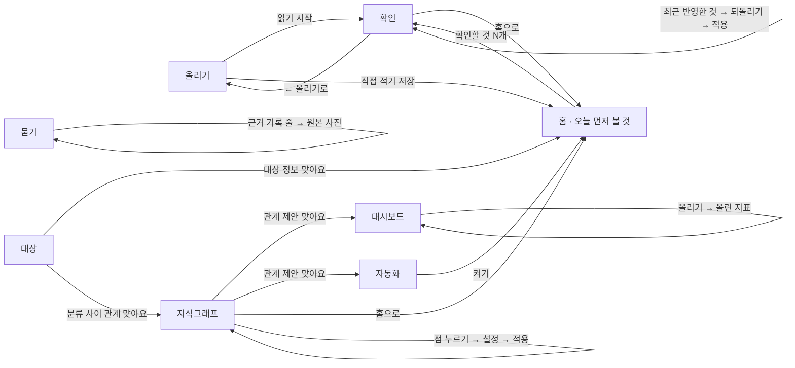

# 화면 흐름도

## 웹

왼쪽 메뉴(홈 · 올리기 · 확인 · 묻기 · 지식그래프 · 대상 · 대시보드 · 자동화)로 어느 화면에서든 오간다. 계정을 고르는 칸은 없다. 처음 열면 빈 올리기에서 시작하고, 처음 [읽기 시작]을 누를 때 생긴 계정이 주소에 붙는다.

- 확인 화면 아래 "최근 반영한 것"에서 [되돌리기]를 누르면 반영 전으로 돌리는 카드가 올라가고, [적용]을 눌러야 되돌아간다.
- 지식그래프에서 점을 누르면 오른쪽에 그 점의 설정 칸이 열린다. 대상·분류 점에는 나가는 관계와 들어오는 관계가 나뉘어 보인다. 고친 것은 카드로 올라가고 [적용]을 눌러야 그림과 표에 반영된다.
- 지식그래프에서 관계를 [맞아요]로 확정하면 대시보드에 "추천 지표", 자동화에 "반복 업무 제안"이 생긴다.
- 자동화의 [켜기] 카드에는 지금 걸린 것과 지난 30일이었다면 걸렸을 수가 보인다. [켜기]를 누르면 홈의 "오늘 먼저 볼 것"이 그 규칙으로 채워진다. 홈에는 걸린 것이 많은 카드 2장과 [확인할 것 N개]만 띄우고, 나머지는 접어 둔다. 걸린 대상과 의존·영향·대체로 이어진 대상은 "이어서 볼 것"으로 함께 보인다.
- 올리기의 [직접 적기]에서 [저장]을 누르면 기록이 바로 홈 표에 들어간다. 처음 보는 대상을 적으면 확인에 "새 대상" 카드가 생긴다.
- 대시보드·자동화의 "말로 만들기"는 대화다. 보낸 말마다 답과 미리보기가 같은 화면에 이어 보이고, [올리기]를 누르면 "올린 지표"에, [켜기]를 누르면 켜 둔 자동화와 홈에 들어간다.
- 홈에서 [이번 주 요약 만들기]를 누르면 "오늘 먼저 볼 것" 아래에 요약이 보인다.
- 묻기 화면은 예시 질문 버튼, 질문 칸, 답하는 모델, [나란히 보기], [묻기] 버튼, "이렇게 찾았어요", 답, "근거 기록 N줄" 표로 이루어진다. 전에 맞다고 고른 질문이면 "확인한 답"이 붙는다. [나란히 보기]를 켜면 "답 1"·"답 2"가 나란히 보이고 답마다 [이 답이 맞아요]가 있으며, 고른 뒤에 어느 쪽이 확정 전·후인지 보인다.
- 대상 화면에서 대상 정보를 확정하면 기록 표에 '품목.최소 재고' 같은 열이 붙고, 그 정보를 쓰는 자동화 결과가 홈에 바로 보인다. 직접 고친 값은 [적용]을 눌러야 반영된다.
- 확인과 대상의 "같은 대상" 카드에서 [나중에]를 누르면 그 카드가 이번 접속 동안 목록 맨 뒤로 간다.
- 기록이 없는 계정은 어느 메뉴를 열어도 네 칸 캔버스가 보이고, ① 칸에서 [읽기 시작]을 누르면 확인으로 간다.
- 처음 올린 사람은 첫 답을 받을 때까지 화면 위 네 단계 띠로 오간다. 확인할 것을 다 답하면 홈으로 가고, 띠의 ④를 누르면 예시 질문이 채워진 묻기가 열린다. 화면 모양은 [wireframe_first_run.png](wireframe_first_run.png).
