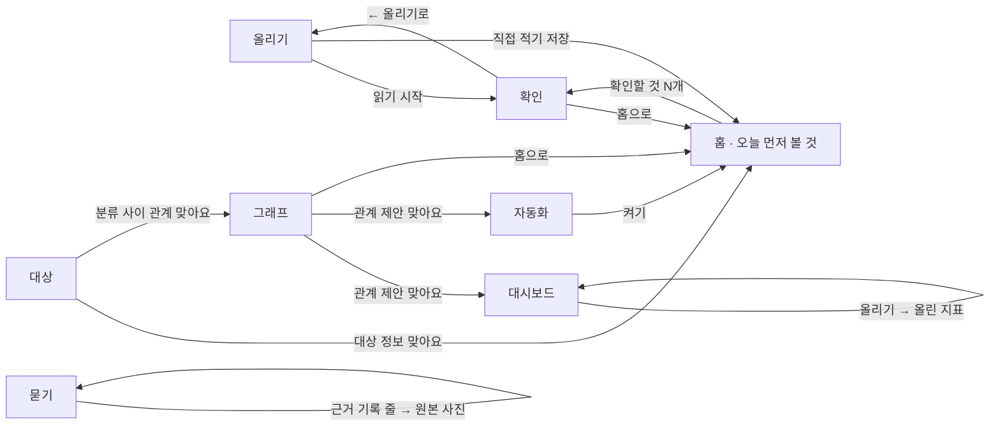

# 화면 흐름도

## 웹

왼쪽 메뉴(홈 · 올리기 · 확인 · 묻기 · 그래프 · 대상 · 대시보드 · 자동화)로 어느 화면에서든 오간다. 사이드바에서 계정을 고르거나 새로 만든다.

- 그래프에서 관계를 [맞아요]로 확정하면 대시보드에 "추천 지표", 자동화에 "반복 업무 제안"이 생긴다.
- 자동화에서 [켜기]를 누르면 홈의 "오늘 먼저 볼 것"이 그 규칙으로 채워진다.
- 올리기의 [직접 적기]에서 [저장]을 누르면 기록이 바로 홈 표에 들어간다. 처음 보는 대상을 적으면 확인에 "새 대상" 카드가 생긴다.
- 대시보드·자동화의 "말로 만들기"에서 [만들어 보기]를 누르면 같은 화면에 "추천 지표"나 "반복 업무 제안" 카드가 올라온다.
- 홈에서 [이번 주 요약 만들기]를 누르면 "오늘 먼저 볼 것" 아래에 요약이 보인다.
- 묻기 화면은 질문 칸, 답하는 모델, [나란히 보기], [묻기] 버튼, 답, "근거 기록 N줄" 표로 이루어진다. [나란히 보기]를 켜면 확정 전·확정 후 답이 나란히 보이고 답마다 [👍]가 있다.
- 대상 화면에서 대상 정보를 확정하면 기록 표에 '품목.최소 재고' 같은 열이 붙고, 그 정보를 쓰는 자동화 결과가 홈에 바로 보인다. 직접 고친 값은 [적용]을 눌러야 반영된다.
